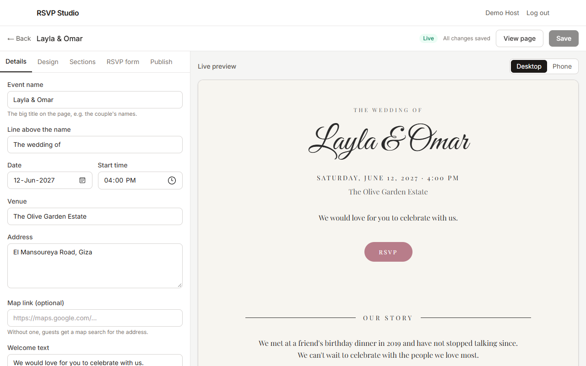
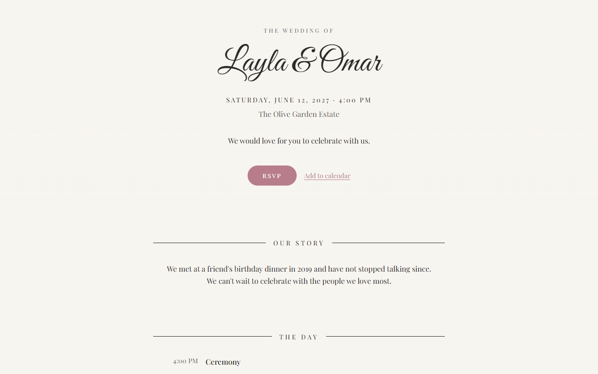
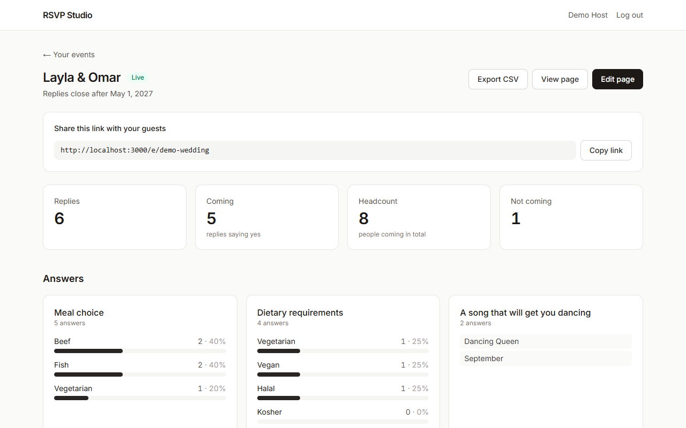

# RSVP Studio

Create a beautiful RSVP page for any event, share one link, and watch the replies come in.

**Live:** [wedding-rsvp-tau-five.vercel.app](https://wedding-rsvp-tau-five.vercel.app)

Hosts sign up, pick a template, choose a theme and the sections they want, build their own RSVP questions and publish. Guests reply from any device. Every event has a dashboard with the headcount, answer breakdowns, a searchable list of replies and a CSV export.



## Features

- **Templates** for weddings, birthdays, parties, baby showers and corporate events
- **Builder with live preview** on desktop or phone width
- **Five themes** (classic, garden, midnight, modern, sunset), a custom accent colour and a cover image
- **Sections you control:** story, schedule, location with map link, countdown, dress code, gifts or registry, FAQ; show, hide and reorder them
- **RSVP question builder:** single and multiple choice (with "Other"), yes/no, short and long answers; required or optional; asked of everyone or only guests who are coming
- **Guest lists:** paste names (and optional emails and party sizes); each guest gets a personal link that fills in their name, caps their party, and later lets them edit their reply; see who has not replied and the response rate
- **Private edit links:** after replying, guests get a link to change their reply later, so plans changing never means a duplicate RSVP
- **Guest options:** party size limits, email off/optional/required, reply deadline, custom thank-you message, add-to-calendar file
- **Event dashboard:** replies, coming, headcount, per-question counts, search and filters, delete, CSV export
- **Dietary needs and allergies:** every template asks, the builder adds them in one click, and a kitchen summary lists each guest’s meal, needs and allergies with a CSV for the caterer
- **Sharing:** copy link, QR code for printed invitations, and link previews in the colours of the event for WhatsApp, iMessage and social apps
- **Drafts and publishing:** pages stay private until published; owners can preview drafts
- **Accounts** with hashed passwords, signed session cookies and rate-limited sign-in; change your name or password, or delete your account and all of its data
- **Duplicate an event** to start the next one from a copy

| Public page                                    | Dashboard                                          |
| ---------------------------------------------- | -------------------------------------------------- |
|  |  |

## Tech stack

Next.js (App Router) · React · TypeScript · Tailwind CSS · Prisma · PostgreSQL · zod · Vitest · GitHub Actions

## Getting started

You need Node.js 24 (see `.nvmrc`) and a PostgreSQL database.

```bash
npm ci
cp .env.example .env
```

Fill in `.env`:

| Variable                   | What it is                                            |
| -------------------------- | ----------------------------------------------------- |
| `POSTGRES_PRISMA_URL`      | Database connection used by the app                   |
| `POSTGRES_URL_NON_POOLING` | Direct connection used for schema changes             |
| `SESSION_SECRET`           | 32+ random characters, e.g. `openssl rand -base64 48` |
| `DEMO_PASSWORD`            | Optional, for the demo account below                  |

No database yet? `npx prisma dev` starts a local Postgres and prints a connection string you can use for both URLs (add `&pgbouncer=true&connection_limit=1` to `POSTGRES_PRISMA_URL`, since the local server takes one connection at a time). Neon, Supabase and Vercel Postgres also work.

Then create the tables, add the demo data and start the app:

```bash
npm run db:push
npm run db:seed   # optional: demo@example.com with a sample wedding and replies
npm run dev
```

Open [http://localhost:3000](http://localhost:3000), sign up and create your first event. The seeded example page is at `/e/demo-wedding`.

## Scripts

| Command             | What it does                         |
| ------------------- | ------------------------------------ |
| `npm run dev`       | Development server                   |
| `npm run build`     | Production build                     |
| `npm test`          | Unit and route tests (Vitest)        |
| `npm run lint`      | ESLint                               |
| `npm run typecheck` | TypeScript                           |
| `npm run format`    | Prettier                             |
| `npm run db:push`   | Create or update the database tables |
| `npm run db:seed`   | Demo account and sample event        |

## Project structure

```
src/
  app/                  pages and route handlers
    e/[slug]/           public event page and calendar file
    dashboard/          events list, templates, event dashboard, builder
    api/                auth, owner and public RSVP endpoints
  components/
    event/              public page: sections, themed RSVP form
    builder/            builder tabs and editors
    dashboard/          stats, answer breakdowns, replies table
  lib/
    events/             content schema, templates, themes, answers, stats, CSV, calendar
prisma/                 schema and demo seed
docs/                   architecture, deployment and workflow
```

How the pieces fit together is described in [docs/ARCHITECTURE.md](docs/ARCHITECTURE.md).

## Deployment

The app runs well on free plans: Vercel for hosting and Neon for Postgres. See [docs/DEPLOYMENT.md](docs/DEPLOYMENT.md).

## License

[MIT](LICENSE)
